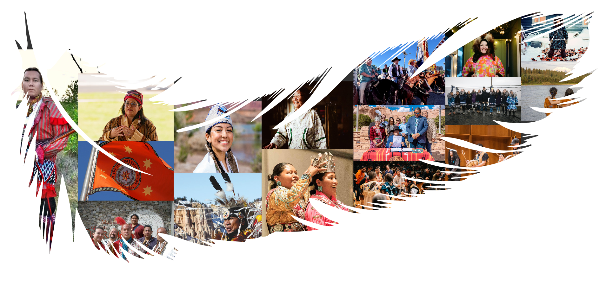

# ArcGIS Hub Custom UI Asset Library

A collection of responsive web components, custom SVG graphics, and layout elements optimized for iframe integration within ArcGIS Hub sites.

## Component Catalog

| Component Name | Visual Preview | Live Iframe Link (for ArcGIS Hub) |
| :--- | :--- | :--- |
| **Native Nations Feather Collage** |  | `https://tessa-vu.github.io/native-nations-visuals/` |

## How to Use in ArcGIS Hub
1. Choose a component from the table above and copy its **Live Iframe Link**.
2. Open your ArcGIS Hub layout editor.
3. Drag an **Iframe card** onto your page.
4. Paste the link into the URL configuration slot.

## Sources

[Jake Tiger, citizen of the Seminole Nation of Oklahoma and the band chief of the Thomas Palmer Band](https://npr.brightspotcdn.com/dims4/default/b85ba5c/2147483647/strip/true/crop/683x1024+0+0/resize/1760x2638!/format/webp/quality/90/?url=http%3A%2F%2Fnpr-brightspot.s3.amazonaws.com%2F7f%2F92%2F81ecc4ac4a9e975968f8a778bce6%2Fimagejpeg-0.JPG), from KOSU article [*Seminole Nation of Oklahoma officials stand in solidarity with Florida tribal nations against 'Alligator Alcatraz'* by Sarah Liese (Twilla)](https://www.kosu.org/race-culture/2025-06-30/seminole-nation-of-oklahoma-officials-stand-in-solidarity-with-florida-tribal-nations-against-alligator-alcatraz).

[Eastern band of Cherokee Indians](https://www.visitsmokies.org/wp-content/uploads/2023/05/Museum-of-Cherokee-Indian-group-pic.jpeg) photo from [Visit Smokies North Carolina](https://www.visitsmokies.org/must-do-activities/cherokee-history-and-culture/).

[Cherokee woman](https://wpcdn.us-east-1.vip.tn-cloud.net/www.tulsakids.com/content/uploads/2026/05/p/f/cherokee-nation-travel-2026-1-819x1024.jpg) from [Tulsa Kids Visit Cherokee Nation page](https://www.tulsakids.com/listings/drivable-destinations/visit-cherokee-nation/).

[Cherokee Nation Flag](https://shop.visitcherokeenation.com/cdn/shop/products/CherokeeNationFlag1000x1000_1200x1200.jpg?v=1596736848) from [Visit Cherokee Nation website gift shop](https://shop.visitcherokeenation.com/products/cherokee-nation-flag).

[Thalia Guerrero, the 2021 Paiute Indian Tribe of Utah queen, an enrolled member of the Kanosh band of Paiutes](https://npr.brightspotcdn.com/b8/c7/0f7dacb9409a9c0a3d264af324d3/220509-indig-c03-p003-ps2-southwestregion-3142.JPG) from KUER article [*The Paiute Indian Tribe of Utah hope to preserve their heritage by saving their language* by Kristine Weller](https://www.kuer.org/arts-culture-entertainment/2022-07-25/the-paiute-indian-tribe-of-utah-hope-to-preserve-their-heritage-by-saving-their-language).

[Southern Paiute man in a ceremonial dress](https://www.nps.gov/articles/images/Paiute-Present.jpg) from the National Park Service's article [*Survival of the Southern Paiute*](https://www.nps.gov/articles/survival-of-the-southern-paiute.htm).

[Camille Uentillie, crowned Miss Navajo nation 2025-2026](https://omnn.navajo-nsn.gov/Portals/0/Images/MissNavajo-2.jpg) from the [Office of Miss Navajo Nation website](https://omnn.navajo-nsn.gov/).

[Navajo Nation President Buu Nygren signing amendments to a 2012 law banning transport of radioactive material across the reservation](https://npr.brightspotcdn.com/dims4/default/c844fc9/2147483647/strip/true/crop/5479x3652+0+0/resize/1760x1174!/format/webp/quality/90/?url=http%3A%2F%2Fnpr-brightspot.s3.amazonaws.com%2F07%2Fb1%2F2307cf374fd4a4599920f5a9038d%2F082924-signing-uranium-transportation-2-2.jpg) from KNAU NPR article [*Navajo Nation amends 2012 law to boost uranium hauling authority* by KNAU staff](https://www.knau.org/knau-and-arizona-news/2024-09-02/navajo-nation-amends-2012-law-to-boost-uranium-hauling-authority).

[Navajo Nation President Buu Nygren riding horseback with other council and community members](https://azmirror.com/wp-content/uploads/2023/07/buu-nygren-horseback-1536x864.jpeg) celebrating 100 years of the Navajo Nation government from AZ Mirror's article [*Navajo Nation Council celebrates 100 years as the governing body for the Navajo people* by Shondiin Silversmith](https://azmirror.com/2023/07/18/navajo-nation-council-celebrates-100-years-as-the-governing-body-for-the-navajo-people/).

[Utqiagvik borough Inupiat members taken by Waats'asdíyei Joe Yates (Haida)](https://www.travelalaska.com/sites/default/files/inline-images/ANC_Barrow_Summer%2023_Watsasdiyei%20Joe%20Yates%20Haida%20%285%29.jpg) from Travel Alaska's [*Iñupiat & St. Lawrence Island Yupik Cultures* page](https://www.travelalaska.com/things-to-do/alaska-native-culture/cultures/inupiat).

[Allison Akootchook Warden, an Inupiaq woman who lives in Anchorage, Alaska](https://static01.nyt.com/images/2017/03/09/blogs/09-lens-inuit-slide-L73X/09-lens-inuit-slide-L73X-superJumbo.jpg) from LENS New York Times article [*An Insider's View of Alaskan Inuit* by Rena Silverman](https://archive.nytimes.com/lens.blogs.nytimes.com/2017/03/08/among-alaskas-inuits-dispelling-televisions-reality/).

[Inuit woman standing over blocks of what seems to be frozen muktak](https://i.natgeofe.com/n/6958707c-4240-40ae-91e9-b14be931c720/09-i-am-inuit.jpg) and [another Inuit elder](https://i.natgeofe.com/n/30ae5bb5-5ba2-40f3-9fb4-268f5ed5580c/08-i-am-inuit.jpg) from National Geographic's article [*Revealing pictures shine a new light on Inuit culture* by Brian Barth with photos from Brian Adams](https://www.nationalgeographic.com/culture/article/inuit-native-american-portraits-alaska).

[Athabascan gathering](https://www.travelalaska.com/sites/default/files/2023-04/Festival_of_Native_Arts_in_Fairbanks_13_2023_Wa_ats_asdiyei_Joe_Yates_0.jpg), with [music performances](https://www.travelalaska.com/sites/default/files/inline-images/Festival_of_Native_Arts_in_Fairbanks_5_2023_Wa_ats_asdiyei_Joe_Yates.jpg), and a [photo of young Athabascan girls](https://www.travelalaska.com/sites/default/files/inline-images/ANC_Interior_Lexi_Qass_uq_Trainer_2023_26_0.jpg) from [Travel Alaska's Athabascan Culture page](https://www.travelalaska.com/things-to-do/alaska-native-culture/cultures/athabascan).